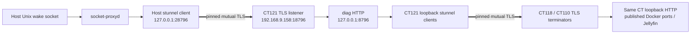

# Diag LAN-spoofing protection: maintenance runbook

Status: implementation PR; **not deployed or live-accepted**. Apply from the owner's
laptop only, with a console available. A merge does not run `diag-security.yml`.
The ordinary `diag` and `host` roles now refuse unapproved legacy/partial updates.
No host firewall, backend, sysctl or guest change was made while building this PR.

## What is fixed, and how

Two authenticated network paths replace source-IP trust and plaintext LAN HTTP:



Every TLS service requires the peer's valid chain **and pinned leaf** and IP SAN;
server mode requires a client certificate. Sessions do not resume across trust
updates. Only each machine's own private key is deployed. No CA private key is
copied to a server. `diag.py` rejects non-loopback upstreams and non-loopback
listeners, so stale configuration fails closed instead of silently leaking keys.
The existing absolute request budget includes tunnel/handshake waits. No app's
native HTTPS implementation is needed, including qui and both qBittorrents.

The authoritative wiring is
`ansible/roles/diag_transport/defaults/main.yml`. Client/server port pairs:

| Caller | Remote TLS listener | Local plaintext backend |
|---|---|---|
| host loopback 28796 | CT121 .158:18796 | CT121 127.0.0.1:8796 |
| diag loopback 8080 | CT118 .156:18080 | CT118 127.0.0.1:8080 (qbit) |
| diag loopback 8090 | CT118 .156:18090 | CT118 127.0.0.1:8090 (qbit-ubits) |
| diag loopback 8081 | CT118 .156:18081 | CT118 127.0.0.1:8081 (qui published 7476) |
| diag loopback 8989 | CT118 .156:18989 | CT118 127.0.0.1:8989 (Sonarr) |
| diag loopback 7878 | CT118 .156:17878 | CT118 127.0.0.1:7878 (Radarr) |
| diag loopback 9696 | CT118 .156:19696 | CT118 127.0.0.1:9696 (Prowlarr) |
| diag loopback 8096 | CT110 .154:18096 | CT110 127.0.0.1:8096 (Jellyfin) |

On CT118 the backend ports are published on that CT by its existing Docker stack;
the TLS terminator never connects to `.156` over vmbr0. Validate those loopback
mappings on the deployed Docker version. Other existing app clients/listeners are
not migrated by this PR; their own plaintext traffic remains their own risk. The
app processes, CT root/network namespace, Proxmox root and private-key storage
are trusted endpoints, not adversaries this scheme can contain.

A compromised physical LAN device or unenrolled guest can still redirect/drop
packets, but cannot authenticate as the host, diag or the application CTs and
cannot decrypt the protected network hops. This is the security fix independent
of cluster-wide enrollment. It does not solve DoS, traffic analysis, compromised
endpoints, key theft from an endpoint, or every other insecure LAN application.

Proxmox source enforcement is an additional, separately staged defense. It binds
all reviewed CT/QEMU NICs to explicit IP/MAC policy and enables ebtables only after
an installed-version compile check. It is **not** the authentication mechanism.
PVE's generated ARP sender-IP checks do not necessarily validate the ARP sender
hardware field against Ethernet source; permitted-IP ARP/NDP payload tricks and
physical-ingress spoofing remain reasons to retain cryptographic transport.

## Preconditions (do not skip)

* Out-of-band Proxmox console, maintenance window, verified backups, no concurrent
  PVE config editors. Do not use `pve-firewall stop` as the emergency rollback.
* Record PVE and **pve-firewall package** versions, host.fw, cluster.fw, all guest
  NICs, bridge attachment, current iptables/ip6tables/ebtables rules/counters and
  both bridge-netfilter sysctls. Keep this evidence local/protected; no payload or
  credential capture. Confirm Docker FORWARD remains ACCEPT and the existing
  `ip-forward-no-drop` setting stays intact. No Docker restart is required here.
* Pinned SSH host keys and the repository's configured SOPS setup on the laptop.
  Existing `diag_keys` are unchanged. No new secret values go in git or chat.
* Back up existing `121.fw`, wake units/scripts, diag program/config/unit and
  enablement state locally on each endpoint with owner-only permissions. The
  program/config may contain secrets: **do not fetch them into transcripts**.
  The Ansible config write also keeps a protected on-CT backup. Do not assume a
  Git revert restores running state or that source-enforcement backups cover the
  transport files.
* `stunnel4` must be available on all four endpoints. CT121 has no internet
  egress: download the Debian 13 **amd64** stunnel4 package and missing dependency
  `.deb`s using a trusted matching Debian environment, then supply local laptop
  paths in `diag_transport_deb_files`. The role copies them and runs
  `apt-get --no-download install` on those files; it never opens egress. Missing
  dependencies abort the preparation, leaving the wake socket disabled. Test the
  bundle on the same CT template beforehand; do not use the ARM sandbox packages.
* New listener ports must be unused. Verify normal HTTP health via loopback on
  CT118 and CT110 without sending/printing valuable credentials. Ensure no other
  firewall blocks the TLS listeners. Changes here do not alter app config or
  restart their Docker services.

## PKI, trust and rotation

On the laptop, outside every git checkout, with OpenSSL installed:

```sh
python3 tools/diag-pki.py init "$HOME/diag-transport-pki"
python3 tools/diag-pki.py check "$HOME/diag-transport-pki"
```

`init` refuses an existing directory or a path inside a checkout. It creates a
0700 directory, owner-only EC P-256 keys, an offline CA and four one-year leaf
certificates with the fixed IP SANs from the wiring above. `check` validates both
TLS purposes, IP SANs, matching keys, exact peer bundles, private permissions and
at least 30 days' remaining validity. It never prints keys. Store this folder on
an encrypted laptop disk and keep an encrypted offline backup; do not copy the CA
key to Proxmox. If storing it through SOPS, do so only on the owner's laptop and
keep the deployed role input directory owner-only. The PR changes no SOPS files.

Renew **before** 30 days remain. For this small pinned set, create a new PKI in a
new directory, quiesce with `prepare` using that directory, and re-run `activate`
with it. No overlapping trust or automatic fallback is added. Replace a stolen
leaf/key by replacing its identity and all peer bundles that pin it; a full new
PKI cutover is the simple supported rotation. Session resumption is disabled and
services restart on identity/trust changes, terminating old connections. Keep the
entry point disabled during partial rotation. Schedule a local expiry check; this
PR does not install a credential-renewal daemon or claim renewal is automatic.

## Stage 1: prepare; diag stays offline

Create an owner-only variable file **outside the repo**, with absolute paths:

```yaml
diag_security_maintenance_ack: true
diag_transport_pki_dir: /absolute/path/to/diag-transport-pki
diag_transport_deb_files:
  - /absolute/path/to/stunnel4_DEBIAN13_AMD64.deb
  # add each missing dependency .deb from the matching Debian release
proxmox_host_diag_firewall_sha256: REPLACE_WITH_SHA256_OF_REVIEWED_EXISTING_121_FW
```

Obtain the firewall hash on the trusted Proxmox console with
`sha256sum /etc/pve/firewall/121.fw` after reviewing the file. This hash is not a
secret. The activation writer refuses an unreviewed existing firewall. Do not
copy an arbitrary old hash or bypass this check.

Run from `ansible/` so existing inventory, pinned SSH and SOPS configuration load:

```sh
ansible-playbook diag-security.yml -e @/absolute/path/to/private-vars.yml \
  -e diag_security_action=prepare
```

Do not use `--limit`, `--tags`, or resume part-way: this is a deliberately ordered
multi-host cutover. `prepare` stops/disables the host entry socket, stops the old
proxy/lifecycle, disables/stops an independently running diag, prepares the two
app-side terminators, then the host client and CT121 tunnels. It may start CT121
for preparation but leaves the diag program disabled/stopped. It changes **no
app native configuration or app service**. Existing app listeners continue to
serve their other clients. Failures stop subsequent plays; the entry socket
remains disabled. In `--check`, package and service changes are skipped; that is
not a live handshake or dependency test.

**Prepare rollback:** keep diag disabled. Stop/disable only `diag-tls.service` on
machines prepared by this PR and restore any previous dedicated unit/config from
the protected pre-window backup, if there was one. Do not uninstall shared
libraries or change app listeners. There is no secure reason to re-enable the
old plaintext diag service. If availability requires legacy rollback, the owner
must explicitly accept that risk and restore the known prior role revision and
all its saved config while retaining console access.

## Stage 2: activate secure-only diag

After confirming preparation on every endpoint:

```sh
ansible-playbook diag-security.yml -e @/absolute/path/to/private-vars.yml \
  -e diag_security_action=activate
```

Activation quiesces again, verifies/reapplies pinned tunnels, installs the
loopback-only diag config/program and service, changes only 121's network rules
to the TLS ports, then installs/enables the wake socket through the host tunnel.
The entire existing cluster.fw is preserved (including any existing ebtables
setting); missing or emergency-disabled cluster configuration is refused. The
host firewall remains off. CT121's default DROP and own source filters remain;
only the narrow allowed endpoint ports change. Its existing DHCP/NDP/RADV options
are not silently rewritten based on assumed defaults.

The host startup script now requires a successful HTTP response **through** mTLS,
not merely an open remote TCP port. The existing 15-minute no-open-connection
idle stop and max-16 wake proxy connections are retained. The host proxy's
IPAddressAllow changes to loopback. Direct LAN HTTP to diag is no longer served.
Initial upstream harvest can retry while PVE reconciles changed port rules; wait
for readiness and the complete app checks before calling cutover accepted.

**Activation rollback:** `diag_security_action=disable` stops/disables the wake
socket and stops/disables diag if CT121 is running, without starting a stopped CT.
It does not dismantle TLS or restore plaintext. Then restore only the affected
files/unit enablement from protected backups or fix forward in a new PR. If
restoring firewall ports, keep diag disabled until transport is coherent. Run
`systemctl daemon-reload` for restored units on the relevant machine. Do not
flush firewall tables, restart Docker or change bridge sysctls for a transport
failure. Ordinary later `--tags diag` needs the PKI/offline package inputs and
`diag_security_activation_ack=true`; `--tags host` additionally needs
`proxmox_host_diag_security_activation_ack=true`. Neither command may reset
cluster ebtables or reintroduce plaintext bases.

## Stage 3: optional complete guest source enforcement

See [lan-guard.md](lan-guard.md). It covers CTs and QEMU, stopped guests and every
NIC, an exact installed pve-firewall version, explicit IPv4/IPv6/DHCP decisions,
CT118 Docker sources, safe flag changes on stopped guests, per-operation backups
and a separate `guard-enable` action. No guessed MACs or VM107/401 addresses are
committed. Transport already protects diag from these guests while inventory is
being completed; unknown guest settings deliberately block global enrollment.

**Enrollment rollback:** use the named backup reported by the tool. Restoring a
NIC flag requires that guest be stopped, and targets changed by another operator
are refused. Roll back `guard-enable` first to restore the preceding ebtables
setting, then the selected guest operation if needed. Leave transport secure.

## Later live acceptance — not run by this PR

1. Test preparation on a clone first, including the Debian13 amd64 offline bundle
   and unprivileged systemd/stunnel sandbox. Review installed package versions.
2. Verify `ss -ltnp` shows only loopback plaintext on CT121; capture **TLS handshake
   metadata only** on vmbr0, never HTTP headers/payloads. Direct `.158:8796` must
   fail. The eight TLS endpoint mappings must all be correct.
3. With disposable canaries, require missing/wrong/unpinned/expired client and
   server certificates to fail before the backend sees any canary header. Test
   all seven upstream reads, real request caps, redaction, denial routes,
   harvested readiness and the existing protected live-acceptance script. Do not
   run the older canary-plant script against LAN HTTP with real credentials; use
   the protected local tunnel path or plant fixtures locally on the app CT.
4. Verify actual cold-start from stopped CT121, startup failure with an invalid
   tunnel, full index/app readiness and 15-minute idle shutdown. Recheck after
   reboot and a normal approved role run. No rule/certificate check substitutes
   for these lifecycle tests.
5. On a fully isolated test bridge with no physical uplink, a disposable sender
   and observer, send one controlled ARP reply with the sender's own Ethernet MAC
   and forbidden **test** sender IPv4 (e.g. 192.0.2.99) to the observer's test MAC.
   Confirm per-NIC ARP-drop counter increments and observer sees no frame; send an
   allowed-source positive control and require it to arrive. Use Scapy or the
   owner's test harness, do not spoof .152/.154/.156/the gateway on vmbr0. Remove
   only the disposable lab afterward; no persistent production neighbor changes.
6. Review physical-switch DAI/IP source guard separately if available. OPNsense
   routed rules do not see same-VLAN traffic that never traverses it. No PVE guest
   chain protects an untrusted physical access port. TLS is retained either way.

## Emergency host connectivity rollback

Only for a bridge/host availability failure, from the console: first disable diag
if possible. Set cluster.fw `enable: 0`, wait for reconciliation and confirm PVE
rules are removed, **then**:

```sh
sysctl -w net.bridge.bridge-nf-call-iptables=0 net.bridge.bridge-nf-call-ip6tables=0
```

`pve-firewall stop` alone does not restore those sysctls. This emergency rollback
removes **all** PVE guest protection including CT121 isolation and may affect
other bridge-netfilter users. Verify host/Docker/guest connectivity and reconcile
Ansible desired state before another run. It is not the default rollback for a
single transport/guest failure.

## Local verification and primary references

Run from repository root (install stunnel4 and OpenSSL locally for real TLS tests):

```sh
python3 -m unittest discover -s tests -p test_diag.py
python3 -m unittest discover -s tests -p test_diag_transport.py -v
python3 -m unittest discover -s tests -p test_lan_guard.py -v
python3 tests/parallel.py
ansible-lint ansible/
cd ansible
ansible-playbook diag-security.yml --syntax-check
ansible-playbook site.yml --syntax-check
```

The existing CI environment does not install stunnel4; binary integration cases
explicitly skip there unless it is present. They were exercised with real
stunnel processes in the development sandbox, using ephemeral local test PKI,
not live credentials. The PKI tests still run wherever OpenSSL is available.
No workflow/gate-file changes or live deployment are bundled into this PR.

* Stunnel options: upstream `doc/stunnel.md`, `verifyChain`, `verifyPeer`,
  `requireCert`, `checkIP`, timeouts, session resumption:
  https://github.com/mtrojnar/stunnel/blob/b611485e29e96e71404967fbaba1ecff15ff0c4c/doc/stunnel.md
* Historical PVE source, not a claim of the installed package version:
  https://github.com/proxmox/pve-firewall/blob/aadddcfd474962c710ad0fb90365a593eb7ce736/src/PVE/Firewall.pm
* PVE firewall documentation: https://pve.proxmox.com/pve-docs/chapter-pve-firewall.html
